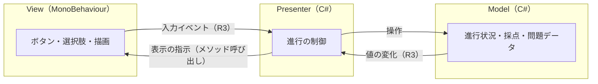
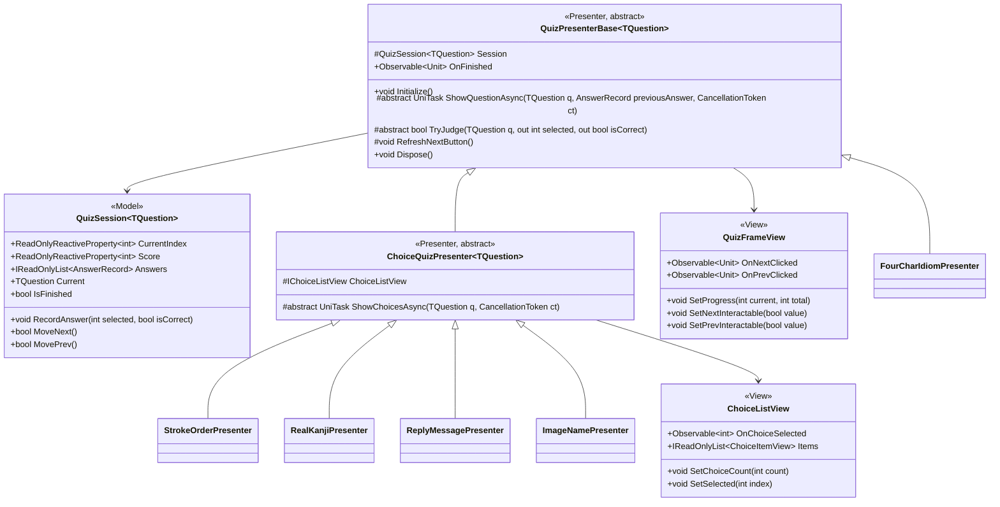
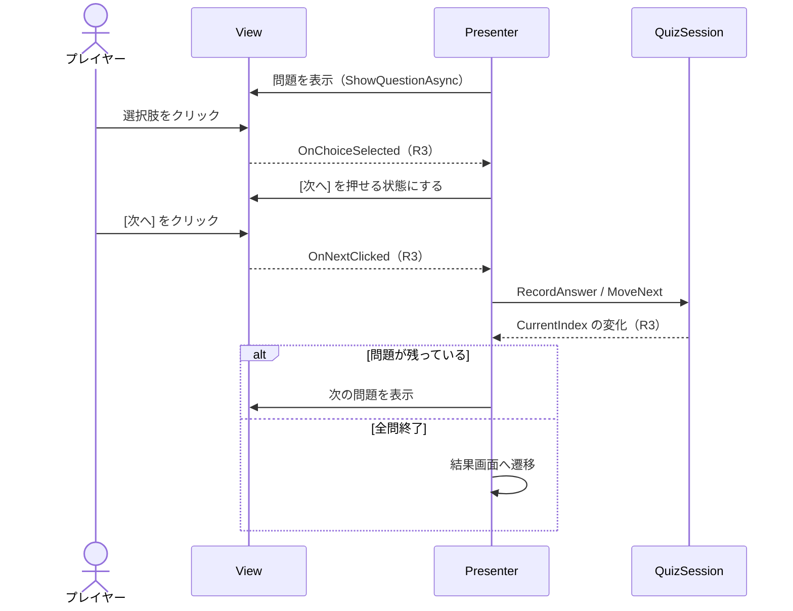
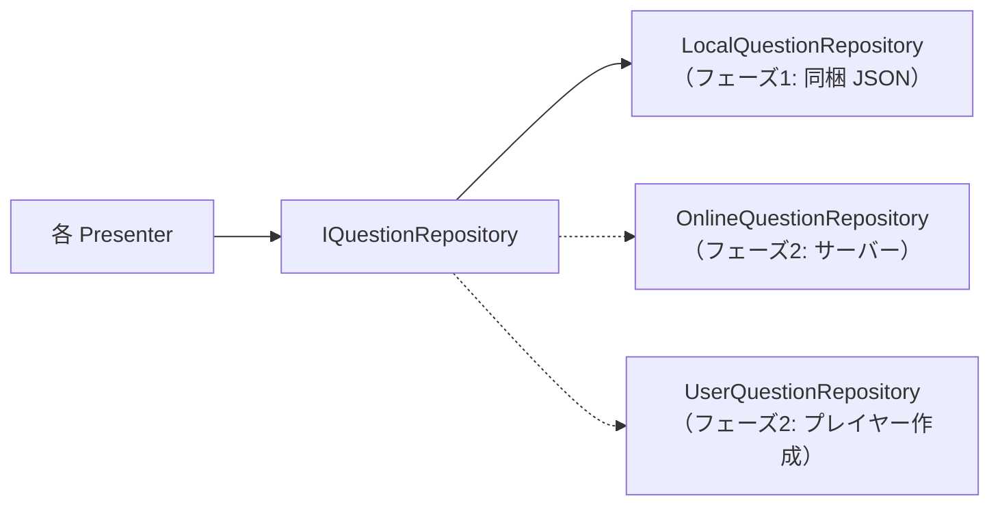

# 漢字クイズ アーキテクチャ設計書

| 項目 | 内容 |
|---|---|
| 状態 | 確定（実装に合わせて更新する） |
| 最終更新 | 2026-11-02 |
| 関連 | [GameSpec.md](GameSpec.md) / [ScreenDesign.md](ScreenDesign.md) / [CodingRules.md](CodingRules.md) |

---

## 1. 採用するアーキテクチャ

**MVP（Model-View-Presenter）** を採用する。

| 技術 | 用途 | 導入時期 |
|---|---|---|
| MVP | 全体の構成 | 最初から |
| R3 | View から Presenter へのイベント通知、Model の値の変化の通知 | 最初から |
| UniTask | 非同期処理（描画、画面遷移、データ読み込み） | 導入済み |
| VContainer | 依存関係の注入（DI） | 5モードが動いたあと、余裕があれば |

### 1.1 MVP を選んだ理由

1. **5つのモードで共通の流れを1回だけ書くため。**
   どのモードも「出題 → 回答 → 判定 → 次の問題 → 結果」の流れは同じ。この流れを Presenter の基底クラスにまとめ、各モードは違う部分だけを書く。
2. **ロジックをテストできるようにするため。**
   Model と Presenter は MonoBehaviour を使わない普通の C# クラスにする。EditMode テストで、採点や選択肢の生成を確認できる。
3. **画面を差し替えやすくするため。**
   View はロジックを持たないので、PC 版とスマートフォン版で View だけを作り分けられる。
4. **フェーズ2の機能を後から足すため。**
   問題データの読み込みを Model 側のインターフェースにしておけば、オンラインの問題やプレイヤーが作った問題に差し替えられる。

### 1.2 VContainer を後回しにする理由

- 1人で2027年1月までに5モードを完成させることを優先する。
- VContainer がなくても、各シーンの「組み立て役」（EntryPoint）が Model・View・Presenter を作ってつなげば MVP は成り立つ。
- EntryPoint を VContainer の LifetimeScope に置き換えるだけで移行できる構成にしておく（6章）。

---

## 2. MVP の役割分担



| 役割 | 持つもの | 持たないもの |
|---|---|---|
| Model | 問題データ、進行状況、回答履歴、採点、選択肢の生成 | UI、MonoBehaviour |
| View | ボタン、テキスト、描画などの見た目 | 判断（正解かどうか、次に何をするか） |
| Presenter | View の入力を受けて Model を操作し、結果を View に表示させる | 見た目の細かい処理、データの保持 |

依存のルールは次のとおり。

- View は Presenter と Model を知らない。入力は R3 の Observable として公開するだけ。
- Model は View と Presenter を知らない。
- Presenter だけが View と Model の両方を知る。

---

## 3. 主要クラス

### 3.1 共通部分



| クラス | 役割 | 種類 |
|---|---|---|
| `QuizSession<TQuestion>` | 問題リスト、現在位置、回答履歴、スコア | Model |
| `AnswerRecord` / `AnswerState` | 1問分の回答（未回答・正解・不正解、選んだ番号） | Model |
| `IChoiceQuestion` | 選択式の問題（選択肢の数と正解の番号）。選択肢の並びは問題を作るときに確定させる | Model |
| `IQuestionRepository<TEntry>` / `LocalQuestionRepository<TEntry>` | 問題データの読み込み口と、同梱の問題セットの JSON（`{ "id", "questions": [...] }`）から読む実装。`TEntry` は JSON の問題1件の型（本物の漢字さがしは `RealKanjiEntry`） | Model |
| `KanjiWordDictionary` / `KanjiWord` | 漢字ごとの使用例（熟語）の辞書。`Data/KanjiWords` の JSON をまとめて読む | Model |
| `KanjiMeaningDictionary` / `KanjiMeaning` | 漢字ごとの意味と例文の辞書。`Data/KanjiMeanings` の JSON をまとめて読む | Model |
| `RubyText` | 読みをつけた文（`{漢字|よみ}`）を、漢字のまま、またはひらがなにして出す。データを確かめるために、読みのない漢字も探せる | Model |
| `DisplaySettings` / `IDisplaySettingRepository` / `PlayerPrefsDisplaySettingRepository` | 表示の設定（出題の字のほかをひらがなにするか）。R3 の `ReadOnlyReactiveProperty` で変化を知らせる。中断メニューと振り返りが同じものを使うので、EntryPoint は `DisplaySettings.Shared` を渡す | Model |
| `IKanjiStrokeSource` / `IKanjiSvgSource` / `StreamingAssetsKanjiStrokeSource` | KanjiVG の SVG の読み込み口。画のパスデータだけか、部品のグループつき（`KanjiSvgStroke`）かの2通り。書き順クイズと本物の漢字さがしで使う | Model |
| `KanjiSvgParser` / `KanjiSvgStroke` / `StrokePathParser` / `StrokeData` | SVG から画のパスデータと、その画が入っている部品のグループ（g 要素の id）を取り出し、座標の列に変換する | Model |
| `KanjiGlyphRenderer` | 漢字1字を画の線（LineRenderer）でまとめて描く。フォントにない字（偽物）も描ける | View |
| `ChalkStrokeGraphic` | 漢字の画を UI の線（MaskableGraphic）として、何画目のどこまで書いたかに合わせて描く。LineRenderer と違い UI の描画順に従うので、黒板消しの跡などで隠せる | View |
| `ChalkTextWriter` | TextMeshPro の字を1字ずつチョークで書くように出す（頂点の色で左から右へ濃くし、チョークの先の画像を動かす）。書いている途中かどうかを `Writing`（R3）で知らせる（チョークの音を鳴らすため） | View |
| `SkipInput` | 演出を飛ばす入力（左クリック、タップ、Enter、スペース）を、演出をしている View が確かめる | View |
| `Difficulty` / `DifficultyExtensions` | 難易度と、その表示名（簡単・常識・困難） | Model |
| `KanjiSet` | 出題範囲の漢字の集まり。JSON から読む。サロゲートペアの漢字も1文字として扱う | Model |
| `ShuffleUtility` | シャッフル処理を1か所にまとめる | Model |
| `QuizPresenterBase<TQuestion>` | 次へ・前へ・結果への遷移など全モード共通の進行 | Presenter |
| `ChoiceQuizPresenter<TQuestion>` | 「N 個から1つ選ぶ」モード共通の判定 | Presenter |
| `QuizFrameView` | ヘッダー、進行バー、次へ・前へボタン、問題を切り替えるときのスライド、Enter・← → のキー操作（`Prefabs/Common/QuizFrame`） | View |
| `QuizModeDefinition` / `QuizModeCatalog` | モードの設定（ID、名前、説明、シーン、遊べるか、難易度ごとの問題数と出題範囲の説明）と一覧。ScriptableObject（`Data/Modes/`）。名前・保存のキー・優先する苦手な問題の数もここで作る | Model |
| `PauseMenuView` / `PauseMenuPresenter` / `PauseMenuEntryPoint` | 中断メニュー。組み立て役もプレハブ（`Prefabs/Common/PauseMenu`）に入っているので、置くだけで使える | View・Presenter |
| `InputGate` | キー操作を一時的に止める（中断メニューを開いている間、シーンの切り替えの途中） | 共通 |
| `CanvasCameraBinder` | プレハブの Screen Space - Camera の Canvas に、起動時に `Camera.main` を設定する | View |
| `IVolumeRepository` / `PlayerPrefsVolumeRepository` | 効果音の音量の保存先 | Model |
| `ChoiceListView` / `ChoiceItemView` | 選択肢の並びと1つ分の選択肢。中身はモードごとの View が `ChoiceItemView.ContentRoot` の下に描く | View |
| `ISceneLoader` / `SceneLoader` / `SceneNames` | シーン遷移。Presenter からはインターフェース経由で使う | 共通 |
| `QuizResult` / `QuizResultStore` | プレイの結果と、結果をシーン間で渡す置き場所 | 共通 |
| `QuizReviewStore` | 振り返り用の問題と回答、振り返りを頼まれた問題の番号の置き場所 | 共通 |
| `ChoiceQuizReviewPresenter<TQuestion>` | 選択式モード共通の振り返り（正解・回答の印、前へ・次へ、結果に戻る） | Presenter |
| `QuizReviewView` | 振り返りのときだけ表示する部品（結果に戻るボタン、その問題の正誤） | View |
| `ChoiceMark` | 振り返りのときに選択肢につける印（正解・選んだ不正解） | View |
| `SingletonMonoBehaviour<T>` | シーンに1つだけ置く MonoBehaviour の基礎クラス。2つ目は消す。シーンをまたいで残すかを Inspector で選べる | 共通 |
| `AudioManager` / `IAudioPlayer` / `SeType` | 効果音を鳴らす（`SingletonMonoBehaviour` を継承）。Presenter は `IAudioPlayer` 経由で使い、AudioManager がなければ `NullAudioPlayer` を渡す | 共通 |
| `KanjiRank` | 正解率と難易度から級（10級〜初段）を決める。級の高さ（難易度をまたいで比べる）と、次の級まであと何問かも求める | Model |
| `IBestRecordRepository` / `PlayerPrefsBestRecordRepository` / `BestRecordUpdate` | 自己ベストの保存先と、1回のプレイで更新したかどうか。`QuizResult.UpdateBestRecord` が1回だけ調べて保存する | Model |
| `WeakQuestionList` / `IWeakQuestionRepository` / `PlayerPrefsWeakQuestionRepository` | 苦手な問題（間違えた問題）のリストと保存先。`OrderCandidates` で苦手な問題を先頭に並べる。問題は文字列で表すので、ほかのモードでも使える | Model |
| `KanjiBook` / `IKanjiBookRepository` / `PlayerPrefsKanjiBookRepository` | 漢字帳。モードごとに正解した字を持つ。`KanjiBook.Collect` で結果の正解した字（Label）を足して保存する（各モードの組み立て役が結果画面へ移るときに呼ぶ）。キーは `KanjiBook_<モード>` | Model |
| `KanjiReadingDictionary` | 漢字ごとの読み（本物の漢字さがしの問題データの `reading`） | Model |
| `QuizRecordEraser` | 保存した記録（自己ベスト・苦手な問題・漢字帳）を、モードの一覧のすべてのモードと難易度について消す（設定の「記録を消す」）。保存先には `Delete` がある | Model |
| `SceneTransitionView` / `ISceneTransition` | プリントを回収して次を配るようにシーンを切り替える（`SingletonMonoBehaviour` を継承）。`SceneLoader` に渡すと演出つきになる。カメラの映像をテクスチャに描いて使うので、各シーンの Canvas は Screen Space - Camera にする | View |
| `ResultItemView` | 結果画面の、問題1つ分の行（○・× のハンコ） | View |
| `QuizLaunchOptions` | プレイ画面を開くときの設定（難易度）。モード選択画面が設定する | 共通 |
| `TitleLaunchOptions` | Title シーンを開くときの設定（最初からモード選択を出すか）。中断メニューの [やめる] と結果画面の [モード選択へ] が設定する | 共通 |
| `IApplicationQuitter` / `ApplicationQuitter` | アプリを終わらせる（エディタでは Play を止める） | 共通 |
| `DebugDifficultySwitcher` | テスト用の難易度切り替え。F1 で表示（`Scripts/DebugTools`、エディタと開発ビルドのみ） | 開発用 |

### 3.2 モードごとの部分

| モード | Presenter | 固有の View | 固有の Model |
|---|---|---|---|
| 書き順クイズ | `StrokeOrderPresenter`, `StrokeOrderReviewPresenter`（描画は `StrokeOrderChoiceDrawer` で共通化） | `StrokeOrderView`, `CumulativeStrokeRenderer`（書き順の描画と枠）, `StrokeAnimationView`（振り返りのお手本） | `StrokeOrderQuestion`, `StrokeOrderQuestionFactory`, `WrongOrderGenerator`, `StreamingAssetsKanjiStrokeSource`, `KanjiSvgParser`, `StrokePathParser` |
| 本物の漢字さがし | `RealKanjiPresenter`, `RealKanjiReviewPresenter`（描画は `RealKanjiChoiceDrawer` で共通化） | `RealKanjiView`, `RealKanjiChoiceContentView`（選択肢の字・読み・振り返りの説明） | `RealKanjiEntry`, `RealKanjiQuestion`, `RealKanjiChoice`, `RealKanjiQuestionFactory`, `FakeKanjiComposer`（部品を入れ替えて偽物を組み立てる） |
| 返信文クイズ | `ReplyMessagePresenter` | `MessageBubbleView`, `TextChoiceView` | `ReplyMessageQuestion` |
| 四字熟語づくり | `FourCharIdiomPresenter` | `IdiomBoardView`（4つの枠と候補） | `FourCharIdiomQuestion` |
| 画像で名前当て | `ImageNamePresenter` | `QuestionImageView`, `TextChoiceView` | `ImageNameQuestion` |

- 選択式の4モードは `ChoiceQuizPresenter` を継承し、判定処理を共通化する。
- 前の問題に戻ったときは、`AnswerRecord` から以前の選択を復元する。選択肢の並びは問題データに固定されているので、戻っても変わらない。
- 四字熟語づくりだけは回答方法が違うので、`QuizPresenterBase` を直接継承する。

### 3.3 タイトルとモード選択

`Scripts/Screens/Title/`（名前空間 `TechC.KanjiQuiz.Screens.Title`）。タイトル・時間割・黒板を1つのシーンで切り替える。

| クラス | 役割 | 種類 |
|---|---|---|
| `DifficultyRecord` | 1つの難易度の記録（自己ベスト、級、次の目標のひとこと、苦手な問題） | Model |
| `ModeSummary` | 時間割の1行と黒板の内容。`ModeSummary.Load` がモードの一覧と保存先（自己ベスト・苦手な問題）から作る | Model |
| `TitlePresenter` | タイトル画面。ロゴの書き順を読んで View に書かせ、[はじめる] で黒板を消させてからモード選択を開く（消すのを飛ばしたら、モード選択の演出も飛ばす）。[← タイトルへ] で戻る。メニューから開く画面（`TitleSubScreens` にまとめた `ITitleSubScreen`）をタイトルの上に開き、開いている間はタイトルのボタンに反応しない | Presenter |
| `SettingsPresenter` | タイトルから開く設定。効果音の音量（`IVolumeRepository`）、ひらがなで表示（`DisplaySettings`）、記録を消す（確認を出してから `QuizRecordEraser` で消し、`OnRecordsErased` で知らせる。組み立て役がこれを受けて `ModeSelectPresenter.ReloadModes` で時間割を読み直す）（`ITitleSubScreen`） | Presenter |
| `KanjiBookPresenter` | 漢字帳。タブ（漢字セット）・ページ・選んだ字を持ち、マス目（集めた字／空のマス／範囲の外）と右のページの内容（`KanjiBookDetail`。意味と例文は表示の設定でひらがなにする）を View に渡す。書き順は `IKanjiStrokeSource` で読み、字を選び直したら読み込みを取り消す。漢字帳は開くたびに読み直し、字の情報（`KanjiInfo`）は最初に字を選んだときに1回だけ読む（`ITitleSubScreen`） | Presenter |
| `CreditsPresenter` | クレジット画面。開いて見せ、[← タイトルへ]（Esc）で閉じて `OnClosed` で知らせる（`ITitleSubScreen`） | Presenter |
| `ModeSelectPresenter` | 時間割の選択、黒板の開閉、難易度の選択、`QuizLaunchOptions` に難易度を入れてモードのシーンを開く | Presenter |
| `ITitleView` / `IModeSelectView` / `ISettingsView` / `IKanjiBookView` / `ICreditsView` と、その実装 `TitleView` / `ModeSelectView` / `SettingsView` / `KanjiBookView` / `CreditsView`（行は `TimetableRowView`、黒板の列は `DifficultyColumnView`） | 表示とキー操作 | View |
| `TitleEntryPoint` | 組み立て役 | 組み立て役 |

### 3.4 1問の流れ



### 3.5 不正解の選択肢の生成ルール（全モード共通）

- 不正解の選択肢は、**正解とも、ほかの不正解とも重複しない**ことを保証する。
- 条件を満たす不正解が作れない問題（1画の漢字など）は、問題リストを作る段階で除外する。
- この2点は EditMode テストで確認する。

---

## 4. データ設計

### 4.1 問題データの持ち方



- 問題は**問題セット**単位の JSON にまとめる。1つの問題セットは1つのモードに対応する。
- JSON の形はフェーズ2でサーバーとやり取りする形と同じにしておく。
- JSON の読み書きは Unity の `JsonUtility` を使う。足りなくなったら Newtonsoft.Json に切り替える。

### 4.2 問題セットの JSON（例：返信文クイズ）

```json
{
  "id": "reply-basic-001",
  "mode": "ReplyMessage",
  "title": "返信文クイズ 基本",
  "version": 1,
  "questions": [
    {
      "id": "q1",
      "situation": "先輩から「明日の会議、資料の準備をお願いできる？」と連絡が来た。",
      "choices": ["承知しました。", "承地しました。", "了承しました。"],
      "correctIndex": 0
    }
  ]
}
```

- `correctIndex` はデータ上では固定でよい。表示するときに選択肢の順番をシャッフルする。
- `id` と `version` はフェーズ2で、問題の更新や重複の判定に使う。

### 4.3 アセットの置き場所

| データ | 置き場所 | 理由 |
|---|---|---|
| 問題セット JSON | `Assets/TechC/KanjiQuiz/Data/Questions/` | TextAsset として EntryPoint から渡す（返信文クイズから使う予定） |
| 本物の漢字さがしの問題データ | `Assets/TechC/KanjiQuiz/Data/RealKanji/` | 難易度ごとの問題セット JSON。`Tools/generate_real_kanji_fakes.py` で作る。`LocalQuestionRepository<RealKanjiEntry>` で読む |
| 漢字の使用例（熟語） | `Assets/TechC/KanjiQuiz/Data/KanjiWords/` | 漢字セットごとの JSON。`Tools/generate_kanji_words.py` で JMdict から作る。`KanjiWordDictionary` で読む |
| 漢字の意味と例文 | `Assets/TechC/KanjiQuiz/Data/KanjiMeanings/` | 漢字セットごとの JSON。AI で作り、`Tools/check_kanji_meanings.py` で確かめる。`KanjiMeaningDictionary` で読む |
| 漢字セット JSON（出題範囲） | `Assets/TechC/KanjiQuiz/Data/KanjiSets/` | TextAsset として EntryPoint から渡す。`Tools/generate_kanji_sets.py` で KANJIDIC2 から作る |
| フォント | `Assets/TechC/KanjiQuiz/Art/Fonts/KleeOne/` | Klee One と TMP フォントアセット（Dynamic）、ライセンス文 |
| KanjiVG の SVG | `Assets/StreamingAssets/KanjiVG/` | ビルド後も読めるようにする。UnityWebRequest で読む |
| 画像で名前当ての画像 | `Assets/TechC/KanjiQuiz/Art/Quiz/ImageName/` | Sprite として扱う |

- KanjiVG の SVG は、基本の字形のファイル（6,701 ファイル）だけを置く。異体字のファイルは使わないので含めない。ビルドサイズが気になる場合は、出題に使う漢字だけに絞る。

---

## 5. シーン構成と画面遷移

| シーン | 内容 |
|---|---|
| `Title` | タイトル画面、モード選択（時間割）、難易度選択（黒板）。1つのシーンの中で切り替える |
| `StrokeOrder` / `RealKanji` / `ReplyMessage` / `FourCharIdiom` / `ImageName` | 各モードのプレイ画面 |
| `Result` | 結果画面（全モード共通） |

- モードごとにシーンを分ける。1人で開発するので、モード同士の干渉を減らすことを優先する。
- タイトル、モード選択、結果の画面も同じく MVP で作る（`TitlePresenter` など）。
- シーン間で渡すのは「選んだモード・難易度」と「結果（回答履歴）」だけ。難易度は `QuizLaunchOptions`、結果は `QuizResultStore`（どちらも静的クラス）で受け渡す。ほかのシーンから「モード選択へ」戻るときは `TitleLaunchOptions.OpenModeSelect` を立てて Title を開く。
- 問題の振り返りは、結果画面から各モードのシーンを開き直して行う。各モードの EntryPoint は、`QuizReviewStore` に振り返りが頼まれていれば出題せずに振り返りの Presenter を作る。
- 実装済みのシーンは `Title`、`StrokeOrder`、`RealKanji`、`Result`。どれも Build Profiles のシーンリストに登録し、先頭は `Title`。
- 画面の詳細は [ScreenDesign.md](ScreenDesign.md) を参照。

---

## 6. 組み立て役（EntryPoint）

各シーンに1つ、Model・View・Presenter を作ってつなぐ MonoBehaviour を置く。
書き順クイズの `StrokeOrderEntryPoint` は、次の流れで動く（実際のコードを短くしたもの）。

```csharp
private async UniTaskVoid InitializeAsync(CancellationToken ct)
{
    reviewView.SetVisible(false);

    // 結果画面から振り返りを頼まれていれば、出題せずに振り返りを開く
    if (QuizReviewStore.TryTakeRequest<StrokeOrderQuestion>(out var questions, out var answers, out int index))
    {
        reviewPresenter = new StrokeOrderReviewPresenter(questions, answers, index, frameView, choiceListView, reviewView, strokeOrderView, sceneLoader);
        reviewPresenter.Initialize();
        return;
    }

    // 難易度（QuizLaunchOptions があれば優先）に合った出題範囲から、ランダムに問題を作る
    var kanjiSet = KanjiSet.FromJson(GetKanjiSetAsset(difficulty).text);
    var factory = new StrokeOrderQuestionFactory(new StreamingAssetsKanjiStrokeSource());
    // 前に間違えた漢字（苦手な漢字）を先頭に並べてから問題を作る。問題数はモードの定義から読む
    var candidates = weakList.OrderCandidates(kanjiSet.Kanji, mode.WeakQuestionCount(difficulty));
    var list = await factory.CreateFromOrderedAsync(candidates, difficulty, choiceCount, mode.QuestionCount(difficulty), ct);

    session = new QuizSession<StrokeOrderQuestion>(list);
    presenter = new StrokeOrderPresenter(session, frameView, choiceListView, strokeOrderView);
    presenter.OnFinished.Subscribe(this, static (_, self) => self.GoToResult()).AddTo(this);
    presenter.Initialize();
}
```

- View への参照は EntryPoint だけが SerializeField で持つ。
- Presenter は `IDisposable` を実装し、R3 の購読と UniTask のキャンセルを `Dispose` でまとめて解除する。EntryPoint の `OnDestroy` で `Dispose` する。
- VContainer を入れるときは、EntryPoint を `LifetimeScope` に置き換える。Presenter と Model のコードは変えなくてよい。

---

## 7. R3 と UniTask の使い分け

| 場面 | 使うもの | 例 |
|---|---|---|
| View の入力を Presenter に伝える | R3 の `Observable` | `OnNextClicked`, `OnChoiceSelected` |
| Model の値の変化を伝える | R3 の `ReactiveProperty` | `CurrentIndex`, `Score` |
| 時間がかかる処理を順番に待つ | UniTask | 書き順の描画、シーン遷移、データ読み込み |

- Model の ReactiveProperty は外には `ReadOnlyReactiveProperty` として公開し、Model の中だけで値を変える。
- Presenter は問題を表示するたびに `CancellationTokenSource` を作り直し、前の問題の処理をキャンセルする。
  - 書き順の描画もこのトークンでキャンセルするので、問題を切り替えても前の描画が混ざらない。

---

## 8. アセンブリとテスト

| アセンブリ | 中身 |
|---|---|
| `TechC.KanjiQuiz` | ゲーム本体 |
| `TechC.KanjiQuiz.Editor` | エディタ拡張（必要になったら） |
| `TechC.KanjiQuiz.Tests` | EditMode テスト |

テストは `Assets/TechC/KanjiQuiz/Tests/EditMode/` にある（2026-11-02 時点で 254 件）。主な対象は次のとおり。

| 対象 | テストクラス |
|---|---|
| 進行と採点 | `QuizSessionTests` |
| 選択式モード共通の進行 | `ChoiceQuizPresenterTests` |
| 振り返り | `ChoiceQuizReviewPresenterTests`, `QuizReviewStoreTests` |
| 結果画面（結果発表の演出、効果音、級、花丸、自己ベスト） | `ResultPresenterTests`, `QuizResultTests`, `QuizResultStoreTests`, `BestRecordTests`, `KanjiRankTests` |
| 漢字セットと難易度の表示名 | `KanjiSetTests` |
| KanjiVG の SVG の読み込み（部品のグループを含む） | `KanjiSvgParserTests`, `StrokePathParserTests` |
| 問題データと熟語の JSON の読み込み | `QuestionDataTests` |
| 意味と例文（読みの書き方、同梱データの確認）、表示の設定 | `RubyTextTests`, `KanjiMeaningDataTests`, `DisplaySettingsTests` |
| 書き順クイズの Model | `WrongOrderGeneratorTests`, `StrokeOrderQuestionFactoryTests` |
| 書き順クイズの Presenter（苦手の印、振り返りのお手本） | `StrokeOrderPresenterTests` |
| 本物の漢字さがし（偽物の組み立て、問題づくり、出題と振り返りの表示） | `FakeKanjiComposerTests`, `RealKanjiQuestionFactoryTests`, `RealKanjiPresenterTests` |
| 苦手な問題 | `WeakQuestionListTests` |
| タイトルとモード選択（記録のまとめ、時間割と黒板の操作） | `ModeSummaryTests`, `ModeSelectPresenterTests`, `TitlePresenterTests`, `SettingsPresenterTests`, `KanjiBookPresenterTests`, `CreditsPresenterTests`, `QuizRecordEraserTests`, `KanjiBookTests` |
| 中断メニュー、キー操作を止める仕組み | `PauseMenuPresenterTests`, `InputGateTests` |
| モードの定義（書き順クイズのアセットの値も確かめる） | `QuizModeDefinitionTests` |
| シャッフル | `ShuffleUtilityTests` |

- View はテスト用の偽物（`Tests/EditMode/Fakes/`）に差し替える。
- `TechC.KanjiQuiz` アセンブリは UniTask、R3.Unity、uGUI、TextMeshPro、Input System を参照する。

Presenter をテストできるように、View は Presenter からインターフェース（`IQuizFrameView` など）経由で使う。

---

## 9. パッケージの導入

| パッケージ | バージョン | 導入方法 | 状況 |
|---|---|---|---|
| NuGetForUnity | 4.5.0 | Git URL `https://github.com/GlitchEnzo/NuGetForUnity.git?path=/src/NuGetForUnity#v4.5.0` | 導入済み |
| R3（本体） | 1.3.1 | NuGetForUnity（`Assets/packages.config`） | 導入済み |
| R3（Unity 向け） | 1.3.1 | Git URL `https://github.com/Cysharp/R3.git?path=src/R3.Unity/Assets/R3.Unity#1.3.1` | 導入済み |
| VContainer | - | Git URL `https://github.com/hadashiA/VContainer.git?path=VContainer/Assets/VContainer` | 後で導入 |

### 9.1 注意：Microsoft.Bcl.AsyncInterfaces

- R3 は `Microsoft.Bcl.AsyncInterfaces` を必要とする。
- Unity 6 のエディタにはエディタ専用の同名 DLL があるため、NuGetForUnity は通常の復元でこれを「導入済み」とみなして入れない。そのままだと R3 のコンパイルが失敗する。
- このため、`Assets/Packages/` の DLL は Git にコミットしておく。
- 入れ直す必要があるときは、エディタで `NugetForUnity.PackageRestorer.Restore(true)`（依存チェックを省く復元）を実行する。

---

## 10. 今のコードからの移行

旧構成のクラスはすべて移行済み。

| 旧クラス | 移行先 |
|---|---|
| `GameContext` | `QuizSession<TQuestion>`（Model） |
| `StrokeOrderQuizMode` | `StrokeOrderPresenter`（進行）、`StrokeOrderQuestionFactory`（問題づくり）、`StrokeOrderEntryPoint`（組み立て） |
| `CumulativeStrokeRenderer` | 同名の View。描画だけを行い、キャンセルに対応 |
| `KanjiDataParser` | `StreamingAssetsKanjiStrokeSource`（読み込み）、`KanjiSvgParser`、`StrokePathParser` |
| `ApplyDifficultyShuffle` | `WrongOrderGenerator`（重複チェックつき） |
| `QuizChoiceItem` | `ChoiceItemView` |

作業の進み具合は次のとおり。

1. ~~R3 を導入する。~~（完了）
2. ~~共通部分を作る。~~（完了）
3. ~~書き順クイズを MVP に載せ替え、レビューで見つかった不具合を直す。~~（完了）
4. ほかの4モードを1つずつ追加する。（本物の漢字さがしは完了。残りは3モード）
5. ~~タイトル、モード選択、結果の画面を作る。~~（完了）
6. 余裕があれば VContainer を導入する。
