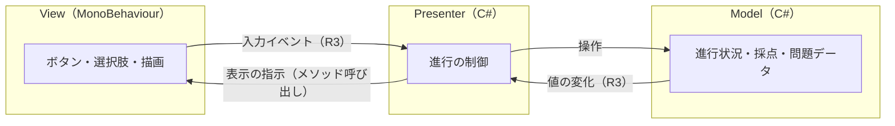
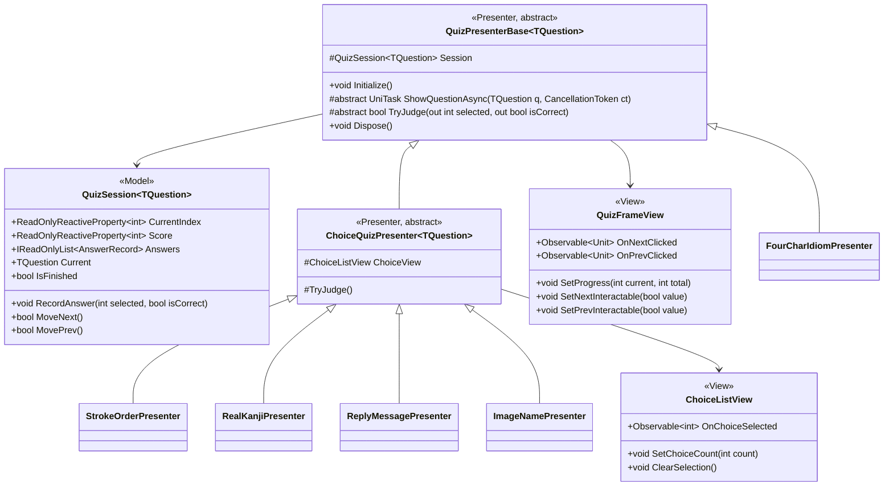
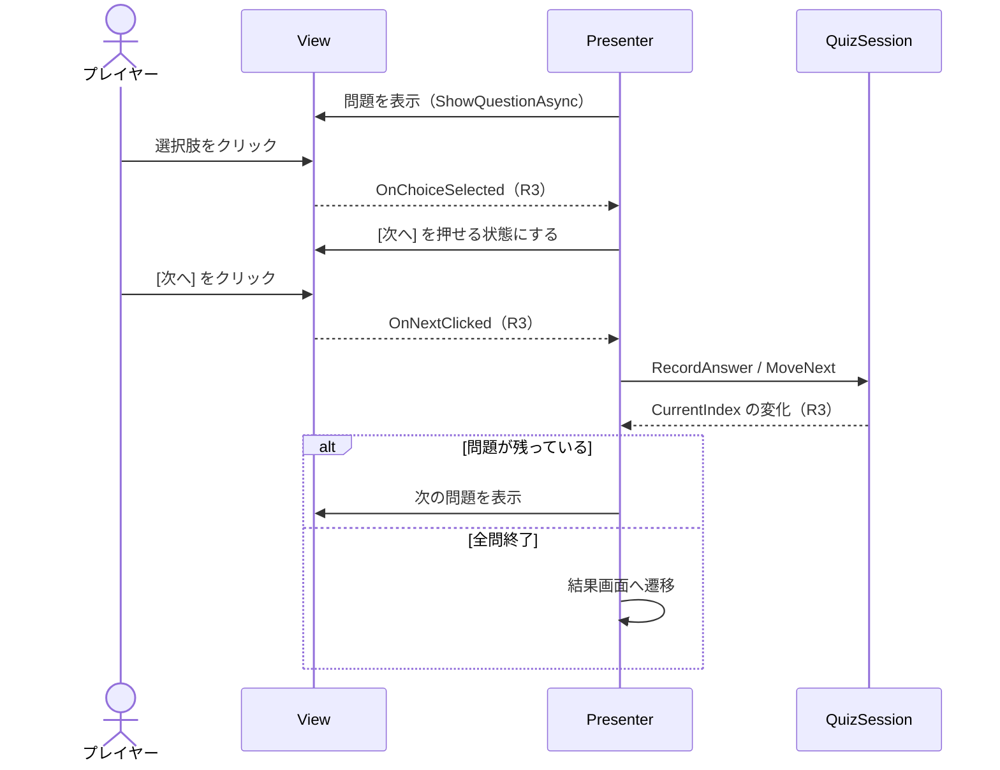
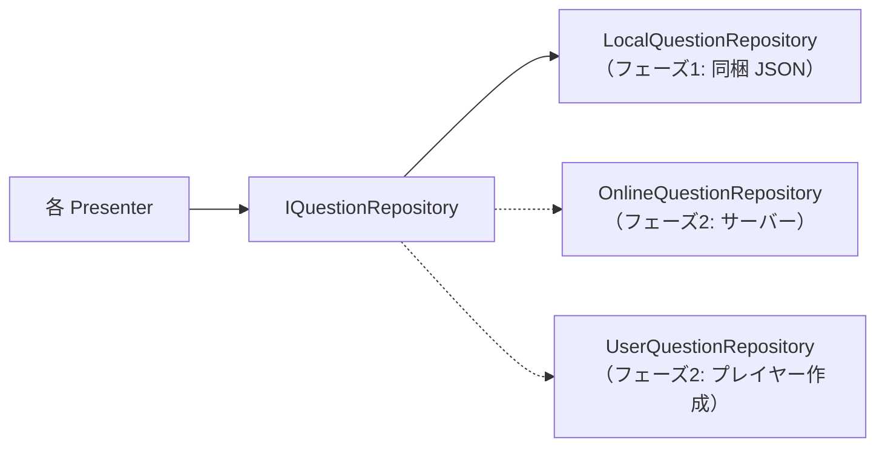

# 漢字クイズ アーキテクチャ設計書

| 項目 | 内容 |
|---|---|
| 状態 | **案**（合意後に「確定」へ変更する） |
| 最終更新 | 2026-10-20 |
| 関連 | [GameSpec.md](GameSpec.md) / [ScreenDesign.md](ScreenDesign.md) / [CodingRules.md](CodingRules.md) |

---

## 1. 採用するアーキテクチャ

**MVP（Model-View-Presenter）** を採用する。

| 技術 | 用途 | 導入時期 |
|---|---|---|
| MVP | 全体の構成 | 最初から |
| R3 | View から Presenter へのイベント通知、Model の値の変化の通知 | 最初から |
| UniTask | 非同期処理（描画、画面遷移、データ読み込み） | 導入済み |
| VContainer | 依存関係の注入（DI） | 5モードが動いたあと、余裕があれば |

### 1.1 MVP を選んだ理由

1. **5つのモードで共通の流れを1回だけ書くため。**
   どのモードも「出題 → 回答 → 判定 → 次の問題 → 結果」の流れは同じ。この流れを Presenter の基底クラスにまとめ、各モードは違う部分だけを書く。
2. **ロジックをテストできるようにするため。**
   Model と Presenter は MonoBehaviour を使わない普通の C# クラスにする。EditMode テストで、採点や選択肢の生成を確認できる。
3. **画面を差し替えやすくするため。**
   View はロジックを持たないので、PC 版とスマートフォン版で View だけを作り分けられる。
4. **フェーズ2の機能を後から足すため。**
   問題データの読み込みを Model 側のインターフェースにしておけば、オンラインの問題やプレイヤーが作った問題に差し替えられる。

### 1.2 VContainer を後回しにする理由

- 1人で2027年1月までに5モードを完成させることを優先する。
- VContainer がなくても、各シーンの「組み立て役」（EntryPoint）が Model・View・Presenter を作ってつなげば MVP は成り立つ。
- EntryPoint を VContainer の LifetimeScope に置き換えるだけで移行できる構成にしておく（6章）。

---

## 2. MVP の役割分担



| 役割 | 持つもの | 持たないもの |
|---|---|---|
| Model | 問題データ、進行状況、回答履歴、採点、選択肢の生成 | UI、MonoBehaviour |
| View | ボタン、テキスト、描画などの見た目 | 判断（正解かどうか、次に何をするか） |
| Presenter | View の入力を受けて Model を操作し、結果を View に表示させる | 見た目の細かい処理、データの保持 |

依存のルールは次のとおり。

- View は Presenter と Model を知らない。入力は R3 の Observable として公開するだけ。
- Model は View と Presenter を知らない。
- Presenter だけが View と Model の両方を知る。

---

## 3. 主要クラス

### 3.1 共通部分



| クラス | 役割 | 種類 |
|---|---|---|
| `QuizSession<TQuestion>` | 問題リスト、現在位置、回答履歴、スコア。今の `GameContext` を置き換える | Model |
| `AnswerRecord` | 1問分の回答（未回答・正解・不正解、選んだ番号） | Model |
| `IQuestionRepository<TQuestion>` | 問題データの読み込み口 | Model |
| `ShuffleUtility` | シャッフル処理を1か所にまとめる | Model |
| `QuizPresenterBase<TQuestion>` | 次へ・前へ・結果への遷移など全モード共通の進行 | Presenter |
| `ChoiceQuizPresenter<TQuestion>` | 「N 個から1つ選ぶ」モード共通の判定 | Presenter |
| `QuizFrameView` | ヘッダー、進行バー、次へ・前へボタン | View |
| `ChoiceListView` / `ChoiceItemView` | 選択肢の並びと1つ分の選択肢 | View |
| `SceneLoader` | シーン遷移と、シーン間で渡すデータ | 共通 |

### 3.2 モードごとの部分

| モード | Presenter | 固有の View | 固有の Model |
|---|---|---|---|
| 書き順クイズ | `StrokeOrderPresenter` | `StrokeOrderChoiceView`（書き順の描画） | `StrokeOrderQuestion`, `WrongOrderGenerator`, `KanjiSvgLoader` |
| 本物の漢字さがし | `RealKanjiPresenter` | `KanjiChoiceView` | `RealKanjiQuestion` |
| 返信文クイズ | `ReplyMessagePresenter` | `MessageBubbleView`, `TextChoiceView` | `ReplyMessageQuestion` |
| 四字熟語づくり | `FourCharIdiomPresenter` | `IdiomBoardView`（4つの枠と候補） | `FourCharIdiomQuestion` |
| 画像で名前当て | `ImageNamePresenter` | `QuestionImageView`, `TextChoiceView` | `ImageNameQuestion` |

- 選択式の4モードは `ChoiceQuizPresenter` を継承し、判定処理を共通化する。
- 四字熟語づくりだけは回答方法が違うので、`QuizPresenterBase` を直接継承する。

### 3.3 1問の流れ



### 3.4 不正解の選択肢の生成ルール（全モード共通）

- 不正解の選択肢は、**正解とも、ほかの不正解とも重複しない**ことを保証する。
- 条件を満たす不正解が作れない問題（1画の漢字など）は、問題リストを作る段階で除外する。
- この2点は EditMode テストで確認する。

---

## 4. データ設計

### 4.1 問題データの持ち方



- 問題は**問題セット**単位の JSON にまとめる。1つの問題セットは1つのモードに対応する。
- JSON の形はフェーズ2でサーバーとやり取りする形と同じにしておく。
- JSON の読み書きは Unity の `JsonUtility` を使う。足りなくなったら Newtonsoft.Json に切り替える。

### 4.2 問題セットの JSON（例：返信文クイズ）

```json
{
  "id": "reply-basic-001",
  "mode": "ReplyMessage",
  "title": "返信文クイズ 基本",
  "version": 1,
  "questions": [
    {
      "id": "q1",
      "situation": "先輩から「明日の会議、資料の準備をお願いできる？」と連絡が来た。",
      "choices": ["承知しました。", "承地しました。", "了承しました。"],
      "correctIndex": 0
    }
  ]
}
```

- `correctIndex` はデータ上では固定でよい。表示するときに選択肢の順番をシャッフルする。
- `id` と `version` はフェーズ2で、問題の更新や重複の判定に使う。

### 4.3 アセットの置き場所

| データ | 置き場所 | 理由 |
|---|---|---|
| 問題セット JSON | `Assets/TechC/KanjiQuiz/Data/Questions/` | TextAsset として EntryPoint から渡す |
| KanjiVG の SVG | `Assets/StreamingAssets/KanjiVG/` | ビルド後も読めるようにする（今はビルド版で読めない） |
| 画像で名前当ての画像 | `Assets/TechC/KanjiQuiz/Art/Quiz/ImageName/` | Sprite として扱う |

- KanjiVG の SVG は全部で約1万2千ファイルある。ビルドサイズが気になる場合は、出題に使う漢字だけを入れる。

---

## 5. シーン構成と画面遷移

| シーン | 内容 |
|---|---|
| `Title` | タイトル画面 |
| `ModeSelect` | モードと難易度の選択 |
| `StrokeOrder` / `RealKanji` / `ReplyMessage` / `FourCharIdiom` / `ImageName` | 各モードのプレイ画面 |
| `Result` | 結果画面（全モード共通） |

- モードごとにシーンを分ける。1人で開発するので、モード同士の干渉を減らすことを優先する。
- タイトル、モード選択、結果の画面も同じく MVP で作る（`TitlePresenter` など）。
- シーン間で渡すのは「選んだモード・難易度」と「結果（回答履歴）」だけ。`SceneLoader` の静的なプロパティで受け渡す。
- 画面の詳細は [ScreenDesign.md](ScreenDesign.md) を参照。

---

## 6. 組み立て役（EntryPoint）

各シーンに1つ、Model・View・Presenter を作ってつなぐ MonoBehaviour を置く。

```csharp
public class StrokeOrderEntryPoint : MonoBehaviour
{
    [SerializeField] private QuizFrameView frameView;
    [SerializeField] private ChoiceListView choiceListView;
    [SerializeField] private TextAsset questionSet;

    private StrokeOrderPresenter presenter;

    private void Start()
    {
        var repository = new LocalQuestionRepository<StrokeOrderQuestion>(questionSet);
        var session = new QuizSession<StrokeOrderQuestion>(repository.LoadAll());
        presenter = new StrokeOrderPresenter(session, frameView, choiceListView);
        presenter.Initialize();
    }

    private void OnDestroy()
    {
        presenter?.Dispose();
    }
}
```

- View への参照は EntryPoint だけが SerializeField で持つ。
- Presenter は `IDisposable` を実装し、R3 の購読と UniTask のキャンセルを `Dispose` でまとめて解除する。
- VContainer を入れるときは、EntryPoint を `LifetimeScope` に置き換える。Presenter と Model のコードは変えなくてよい。

---

## 7. R3 と UniTask の使い分け

| 場面 | 使うもの | 例 |
|---|---|---|
| View の入力を Presenter に伝える | R3 の `Observable` | `OnNextClicked`, `OnChoiceSelected` |
| Model の値の変化を伝える | R3 の `ReactiveProperty` | `CurrentIndex`, `Score` |
| 時間がかかる処理を順番に待つ | UniTask | 書き順の描画、シーン遷移、データ読み込み |

- Model の ReactiveProperty は外には `ReadOnlyReactiveProperty` として公開し、Model の中だけで値を変える。
- Presenter は問題を表示するたびに `CancellationTokenSource` を作り直し、前の問題の処理をキャンセルする。
  - 今の書き順描画は、問題を切り替えても前の描画が止まらない不具合がある。この仕組みで直す。

---

## 8. アセンブリとテスト

| アセンブリ | 中身 |
|---|---|
| `TechC.KanjiQuiz` | ゲーム本体 |
| `TechC.KanjiQuiz.Editor` | エディタ拡張（必要になったら） |
| `TechC.KanjiQuiz.Tests` | EditMode テスト |

テストの対象は次の4つ。

- `QuizSession` の進行と採点
- 不正解の選択肢が正解やほかの不正解と重複しないこと
- 問題セット JSON の読み込み
- Presenter の進行（View をテスト用の偽物に差し替えて確認する）

Presenter をテストできるように、View は Presenter からインターフェース（`IQuizFrameView` など）経由で使う。

---

## 9. パッケージの導入

| パッケージ | バージョン | 導入方法 | 状況 |
|---|---|---|---|
| NuGetForUnity | 4.5.0 | Git URL `https://github.com/GlitchEnzo/NuGetForUnity.git?path=/src/NuGetForUnity#v4.5.0` | 導入済み |
| R3（本体） | 1.3.1 | NuGetForUnity（`Assets/packages.config`） | 導入済み |
| R3（Unity 向け） | 1.3.1 | Git URL `https://github.com/Cysharp/R3.git?path=src/R3.Unity/Assets/R3.Unity#1.3.1` | 導入済み |
| VContainer | - | Git URL `https://github.com/hadashiA/VContainer.git?path=VContainer/Assets/VContainer` | 後で導入 |

### 9.1 注意：Microsoft.Bcl.AsyncInterfaces

- R3 は `Microsoft.Bcl.AsyncInterfaces` を必要とする。
- Unity 6 のエディタにはエディタ専用の同名 DLL があるため、NuGetForUnity は通常の復元でこれを「導入済み」とみなして入れない。そのままだと R3 のコンパイルが失敗する。
- このため、`Assets/Packages/` の DLL は Git にコミットしておく。
- 入れ直す必要があるときは、エディタで `NugetForUnity.PackageRestorer.Restore(true)`（依存チェックを省く復元）を実行する。

---

## 10. 今のコードからの移行

| 今のクラス | 移行先 |
|---|---|
| `GameContext` | `QuizSession<TQuestion>`（Model。MonoBehaviour をやめる） |
| `StrokeOrderQuizMode` | `StrokeOrderPresenter`（進行）と `StrokeOrderEntryPoint`（組み立て）に分ける |
| `CumulativeStrokeRenderer` | `StrokeOrderChoiceView` の中で使う。キャンセル処理を追加する |
| `KanjiDataParser` | `KanjiSvgLoader`（Model）。読み込み先を StreamingAssets に変える |
| `ApplyDifficultyShuffle` | `WrongOrderGenerator`（Model）。重複チェックを追加する |
| `QuizChoiceItem` | `ChoiceItemView` |

移行の手順は次のとおり。

1. R3 を導入する。
2. 共通部分（`QuizSession`、`QuizPresenterBase`、`ChoiceQuizPresenter`、`QuizFrameView`、`ChoiceListView`）を作る。
3. 書き順クイズを MVP に載せ替え、レビューで見つかった不具合を直す。
4. ほかの4モードを1つずつ追加する。
5. タイトル、モード選択、結果の画面を作る。
6. 余裕があれば VContainer を導入する。
