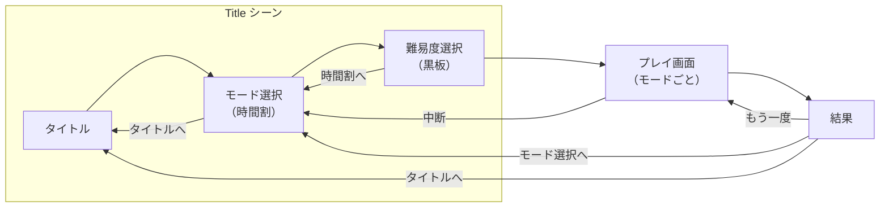

# 漢字クイズ 画面設計書

| 項目 | 内容 |
|---|---|
| 状態 | 確定（実装に合わせて更新する。未実装の画面は案） |
| 最終更新 | 2026-10-31 |
| 関連 | [GameSpec.md](GameSpec.md) / [Architecture.md](Architecture.md) |

---

## 1. 前提

| 項目 | 内容 |
|---|---|
| 対象端末 | PC（Windows）。余裕があればスマートフォンにも対応する |
| 基準解像度 | 1920×1080（16:9） |
| 入力 | マウス。キーボードでも操作できるようにする（1.2） |
| UI | uGUI + TextMeshPro |

### 1.1 スマートフォン対応を見越した決まり

あとからスマートフォンに対応しやすいように、最初から次のようにしておく。

- Canvas Scaler は **Scale With Screen Size**、基準 1920×1080、Match 0.5 にする。
  - StrokeOrder、RealKanji、Result のシーンは設定済み。
- ボタンや選択肢は、指で押せる大きさにする（基準解像度で縦 120px 以上）。
- マウスオーバーでしか見えない情報は作らない。
- 画面の端には重要な UI を置かない（スマートフォンのノッチ対策）。

### 1.2 キーボード操作

| キー | 操作 |
|---|---|
| 1〜6（テンキーも可） | 選択肢を選ぶ（実装済み） |
| Enter / Space / → | 次へ（実装済み。結果発表の演出中は演出を飛ばす） |
| ← | 前の問題へ（実装済み） |
| Esc | 中断メニューを開く・閉じる（実装済み） |
| F1 | テスト用の難易度切り替えボタンの表示・非表示（エディタと開発ビルドのみ、実装済み） |

### 1.3 フォント

- **Klee One**（SIL Open Font License 1.1）を使う。教科書体に近い字形で、漢字の形が問われるゲームに向いている。
- TextMeshPro のフォントアセットは Dynamic にし、TMP Settings の既定のフォントにしている。
- 背景は学校で配られるプリントの画像（少しくすんだ再生紙に繊維の粒と印刷の外枠）、文字は濃いグレー（#2B2B2B）、強調色は朱色（#C84B31）。
- 画面の切り替えは、前の画面のプリントを回収して次の画面のプリントを配る（全画面共通。GameSpec.md 4.3）。新しい画面の Canvas は Screen Space - Camera で作る。

---

## 2. 画面遷移



- タイトル・モード選択・難易度選択は、1つの `Title` シーンの中で切り替える（2026-10-30 に決定）。シーンを読み込み直さないので、切り替えに時間がかからず、画面どうしをつなぐ演出も作りやすい。
- ほかのシーンから「モード選択へ」戻るときは、`Title` シーンを開き、最初からモード選択（時間割）を出す。

---

## 3. 各画面

### 3.1 タイトル（黒板にチョークで書くタイトル）

2026-10-31 に決定。教室の前の黒板いっぱいに、チョークでロゴを書く。モード選択・難易度選択と同じ黒板を使い回す。

```
┌──────────────────────────────────────────┐
│ ┌──────────────────────────────────────┐ │
│ │                          日直：＿＿＿ │ │
│ │          漢 字 ク イ ズ               │ │ ← チョークで1画ずつ書く
│ │     ― 書き順・本物の漢字・四字熟語 ―    │ │
│ │            [ はじめる ]               │ │ ← マグネット
│ │  [設定] [漢字帳] [クレジット] [おわる]   │ │
│ └──────────────────────────────────────┘ │
│        KanjiVG © Ulrich Apel (CC BY-SA 3.0) │
└──────────────────────────────────────────┘
```

- ロゴ「漢字クイズ」は KanjiVG の書き順で、チョークの線を1画ずつ引いて書く（カタカナも KanjiVG にある）。書き終わるとメニューのマグネットが貼られる。
- メニューは はじめる・設定・漢字帳・クレジット・おわる。設定は 3.7、漢字帳は 3.8、クレジットは 3.9。どれも閉じるとタイトルに戻る（ロゴは書き直さない）。
- [はじめる] を押すと、モード選択へ次の順に移る（モックアップは claude.ai のアーティファクト「黒板の消し方とチョークの字」の案 B）。
  1. マグネットが外れて落ちる
  2. 黒板消し（白い面を下にして横向きに持つ）を、上から下へ左下がりの斜めに5回ほど引いて、タイトルを左から順に消す
  3. 黒板が右上へ縮み、時間割の横の大きさになる
  4. 左から時間割表が貼られる
  5. 黒板に選んだモードの内容をチョークで1字ずつ書き、[この授業を受ける] を出す
- **どの演出もクリックか Enter・スペースで飛ばせる**。消している途中で飛ばしたら、時間割への移動もまとめて飛ばす。チョークの字を書いている途中なら、すぐに全部出す。
- 時間割の [← タイトルへ] で戻ると、黒板がタイトルの大きさに戻り、ロゴをもう一度書く。
- KanjiVG のクレジットはタイトル画面の下に表示する（クレジット画面ができたあとも残す）。

### 3.2 モード選択（教室の時間割表）

2026-10-30 に決定。見た目は「教室」。モードを授業に見立て、壁に貼った時間割表から選ぶ。

```
┌──────────────────────────────────────────┐
│ [← タイトルへ]                             │
│ ┌──────────────┐ ┌─────────────────────┐ │
│ │   時 間 割    │ │ 1時間目              │ │
│ │1時間目 書き順 5級│ │ 書き順クイズ          │ │
│ │2時間目 本物   7級│ │ 漢字の正しい書き順を、 │ │
│ │3時間目 自習     │ │ 3つの図から選ぶ。     │ │
│ │4時間目 自習     │ │ 簡単[5級] 常識[6級] 困難― │ │
│ │ ― 昼休み ―    │ └─────────────────────┘ │
│ │5時間目 自習     │      [この授業を受ける]   │
│ │6時間目 自習     │                         │
│ └──────────────┘                         │
└──────────────────────────────────────────┘
```

- 左に時間割表（`QuizModeCatalog` の順に1時間目から並べる）。右に黒板。
- 時間割の各行：時限、モード名、そのモードで取った一番上の級（ハンコ）。
- まだ作っていないモードは「自習」と書き、かっこでモード名と「準備中」を添える。選べるが、[この授業を受ける] は押せない。
- 右の黒板：選んだモードの時限、モード名、説明、難易度ごとの級。選ぶたびにチョークで1字ずつ書く（クリックか Enter で飛ばせる）。
- [この授業を受ける] で難易度選択（3.3）へ。右の黒板が画面いっぱいに広がる。
- キー操作：↑↓・1〜6 で選ぶ、Enter で決める、Esc でタイトルへ。
- モードが7つ以上になったら、時間割の見せ方を考え直す（今は6つ）。

### 3.3 難易度選択（画面いっぱいの黒板）

```
┌──────────────────────────────────────────┐
│ [←時間割へ] 書き順クイズ  漢字の正しい書き順を…   │
│ ─────────────────────────────────────── │
│  簡単   [5級] │ (常識)  [6級] │  困難   まだ   │
│  小学漢字から5問│ 常用漢字(よく…)│ 常用漢字(あまり…)│
│  ベスト 5/5   │ ベスト 4/7   │ ベスト ―      │
│  全問正解！    │ あと1問で5級！ │ 全問正解で初段  │
│              │              │              │
│  苦手な漢字    │ 苦手な漢字     │ 苦手な漢字     │
│  なし         │ [援][施]      │ なし          │
│                            [常識ではじめる]  │
└──────────────────────────────────────────┘
```

- 黒板を画面いっぱいにし、チョークの線で3列に分けて難易度ごとに板書する。
- 列ごとに出すもの：難易度名、級（チョークのハンコ）、出題範囲と問題数、自己ベスト、ひとこと、苦手な漢字。
  - ひとこと：全問正解なら「全問正解！」、記録があれば「あと N 問で ○級！」、記録がなければ「全問正解で ○級」。
  - 苦手な漢字：`WeakQuestionList` に残っている字（多いときは先頭から数字まで）。なければ「なし」。
  - 四字熟語づくりでは見出しを「苦手な熟語」にし（モードの定義の `questionNoun`）、熟語は小さめの字で4つまで、熟語の途中で改行しないように書く。
- 選んだ難易度の見出しを黄色いチョークの丸で囲み、ほかの列は少し薄くする。
- 黒板を開いたときは、まだ全問正解していない一番やさしい難易度を選んでおく（全部全問正解なら困難）。
- ボタンは黒板に貼るマグネット：[← 時間割へ]（左上）と [○○ではじめる]（右下）。
- 難易度がないモードでは、列を1つだけにする。
- キー操作：← →・1〜3 で選ぶ、Enter ではじめる、Esc で時間割へ。
- 決めた案の見た目（モックアップ）は claude.ai のアーティファクト「モード選択画面のレイアウト案」にある。

### 3.4 プレイ画面（全モード共通の枠）

```
┌──────────────────────────────────────────┐
│ 書き順クイズ（簡単）     3 / 10 問 [メニュー] │ ← ヘッダー
│ ■■■□□□□□□□                             │ ← 進行バー
├──────────────────────────────────────────┤
│                                          │
│              問題エリア                   │ ← モードごとに変わる
│                                          │
├──────────────────────────────────────────┤
│                                          │
│              回答エリア                   │ ← モードごとに変わる
│                                          │
├──────────────────────────────────────────┤
│ 操作キーの案内  [← 前へ]       [次へ →]  │ ← フッター
└──────────────────────────────────────────┘
```

- [メニュー] で中断メニュー（続ける、最初からやり直す、やめる（時間割へ）、効果音の音量、出題の字のほかは ひらがなで表示）を開く。詳細は GameSpec.md 4.4。
- 新しいモードのシーンは、シーンテンプレート「漢字クイズのモード」から作る（GameSpec.md 4.6）。

- ヘッダー、進行バー、フッターは全モード共通のプレハブにする。
- 回答を選ぶまで [次へ] は押せない状態にする。

### 3.5 プレイ画面（モードごとの中身）

**書き順クイズ**

```
│  この漢字の正しい書き順はどれ？     「漢」     │
├──────────────────────────────────────────┤
│ ( ) 丶 氵 氵 汁 …（1画ずつ積み上げた図）       │
│ ( ) 丶 氵 氵 汁 …                           │
│ ( ) 丶 氵 氵 汁 …                           │
```

- 画数が多い漢字は横に長くなる。横幅に収まらないときは、図を縮小して1行に収める（実装済み）。
- 1段階ずつの図を黒い四角で囲む（漢字練習帳のマス目のイメージ）。
- 行のどこをクリックしても、その行の選択肢を選べる。
- 振り返りのときは、正解の行を緑、選んだ不正解の行を赤にし、行の右端に「正解」「あなたの回答」を出す。

**本物の漢字さがし**

```
│        本物の漢字はどれ？                     │
├──────────────────────────────────────────┤
│        ┌────────┐    ┌────────┐          │
│        │   偽   │    │   本   │          │
│        │  ジ    │    │  カイ   │          │
│        └────────┘    └────────┘          │
│        ┌────────┐    ┌────────┐          │
│        │   偽   │    │   偽   │          │
│        │  セイ   │    │  ホウ   │          │
│        └────────┘    └────────┘          │
```

- 4つの選択肢を 2×2 に大きく並べ、漢字の下に読みを出す（GameSpec.md 2.1、実装済み）。1つの選択肢は 700×300、字は 1辺 210px ほど。
- 漢字は4つとも KanjiVG の線で完成形を描く（偽物はフォントにないため、本物もそろえる）。
- 前に間違えた漢字のときは、問題文の右に「苦手」のハンコを出す。
- 振り返りでは、問題文の場所に3行で、本物の読みと使用例（熟語）、意味、例文を出す（例文の中の本物の字は朱色）。選択肢の上に収まるよう、字は自動で小さくなる（22〜32）。各選択肢は字と読みを左へ寄せ、右に説明（「本物」か、偽物の部品の組み合わせ）を出す。
- 中断メニューで「ひらがなで表示」を ON にすると、意味と例文の漢字を、本物の字のほかはひらがなで出す。

```
│ 本物は「海」（カイ）　使用例：海外（かいがい）、北海道（ほっかいどう）、海上（かいじょう） │
│ 意味：地球の上に広がる、しおからい水のあつまり。                │
│ 例文：夏休みに家族で海へ泳ぎに行った。                          │
├──────────────────────────────────────────┤
│  ┌──────────────┐  ┌──────────────┐  │
│  │ 偽   氵＋舎   │  │ 本   本物     │  │
│  │ シャ （捨の右側）│  │ カイ          │  │
│  └──────────────┘  └──────────────┘  │
```

**返信文クイズ**

```
│  ┌──────────────────────────────┐        │
│  │ 先輩：明日の会議、資料の準備を   │        │
│  │ お願いできる？                  │        │
│  └──────────────────────────────┘        │
├──────────────────────────────────────────┤
│  [ 承知しました。         ]              │
│  [ 承地しました。         ]              │
│  [ 了承しました。         ]              │
```

- 状況はチャット風の吹き出しで見せる。

**四字熟語づくり**

```
│        空いたマスに字を入れて、四字熟語をつくろう   [苦手]   │ ← 苦手な熟語のときにハンコ
│  ┌─────────────────────────────────────┐  │
│  │ 意味：ひとつのことで、ふたつの得をすること。        │  │ ← いつも表示（ヒント）
│  └─────────────────────────────────────┘  │
│           [一] [ ？ ] [二] [ ？ ]                  │ ← 4つのマス（1辺 190px）
│        [鳥][岩][石][羽][目][頭]                    │ ← 候補（6列、最大12。1辺 120px）
```

- 実装済み（2026-11-03、`FourCharIdiom.unity`）。上から問題文、意味の欄（薄い黄色）、4つのマス、候補（6列×最大2段）。問題を切り替えるときは、この4つがスライドする。
- 候補を押すと左から最初の空いたマスに入る（入れた字は青）。埋めたマスを押すと候補に戻る。使った候補は薄くなる。
- 候補の右下に、押すキー（1〜9・0・-・^）を小さく出す。左下の操作の案内は「数字キー：字を入れる　Back：戻す／Enter：次へ　←：前へ　Esc：メニュー」。
- 振り返りでは、問題文の場所に「正解は「○○」（よみ）」と例文（熟語は朱色）を出す。入れた字が正しいマスは緑、まちがったマスは赤。
- ドラッグ操作はスマートフォン対応のときに検討する。

**画像で名前当て**

```
│            ┌──────────┐                  │
│            │  (画像)   │                  │
│            └──────────┘                  │
├──────────────────────────────────────────┤
│  [ 蒲公英 ]  [ 向日葵 ]  [ 紫陽花 ]  [ 秋桜 ] │
```

### 3.6 結果

```
┌──────────────────────────────────────────┐
│                  結果                     │
│              5 / 7 問 正解               │
│                                          │
│  花丸     1. 漢  ○   6. 字  ×    [5級]    │
│ (全問     2. 令  ○   7. …       自己ベスト │
│  正解)    …                    6 / 7 問  │
│                                 更新！    │
│   [もう一度]          [問題を振り返る]       │
└──────────────────────────────────────────┘
```

- 左に全問正解の花丸、真ん中に問題ごとの ○×（○ はハンコの画像）、右に級のハンコと自己ベストを置く。
- 演出の順番は GameSpec.md 3.0 を参照。

- [もう一度] の右に、同じ大きさの [問題を振り返る] を置く。最初に間違えた問題から振り返りを開く（詳細は GameSpec.md 3.5）。
- 一覧の問題をクリックしても、その問題の振り返りを開く。
- 左下に [モード選択へ]、右下に [タイトルへ] を置く（演出中は隠す）。結果がないときも押せる。

---

### 3.7 設定

2026-10-31 に決定（モックアップは claude.ai のアーティファクト「設定・漢字帳・クレジットの案」）。

**タイトルから開く設定（S1：黒板に板書）**

```
┌──────────────────────────────────────────┐
│ ┌──────────────────────────────────────┐ │
│ │[←タイトルへ]       せってい             │ │
│ │  効果音の音量        ━━━━━━━●━━━       │ │ ← チョークのつまみ
│ │  出題の字のほかは      （しない）（する） │ │
│ │  ひらがなで表示                         │ │
│ │  記録を消す          ［消す］           │ │ ← 確認してから消す
│ └──────────────────────────────────────┘ │
└──────────────────────────────────────────┘
```

- タイトルの黒板の中身を設定に入れかえる（黒板の大きさはタイトルのまま）。
- 項目：効果音の音量、出題の字のほかは ひらがなで表示、記録を消す（自己ベスト・苦手な漢字・漢字帳。押すと確認を出す）。BGM の音量は、BGM を作るまで出さない。
- [設定] を押すと、[はじめる] と同じようにマグネットが落ちて黒板消しでタイトルを消し、黒板に設定を出す。閉じると、ロゴを書き終えた状態のタイトルにすぐ戻る。
- ひらがなで表示は「しない」「する」の選んだ方をチョークの丸で囲む。記録を消す [消す] は確認（「ほんとうに記録を消しますか？」[消す]・[やめる]）を出し、消したら説明の文を「記録を消しました」にする。確認を出しているときの Esc は確認だけを閉じる。
- 記録を消したら、時間割と黒板の記録も読み直す。
- 中断メニューと同じ設定（`Volume_Se`、`Option_Hiragana`）を読み書きする。

**プレイ中に開く設定（S2：連絡帳）**

- 中断メニュー（Esc か [メニュー]）を、机の上に開いた連絡帳の見た目に作りかえる。続ける・最初からやり直す・やめる（時間割へ）と、効果音の音量・ひらがなで表示を1冊にまとめる。
- プレイ中は「机の上のプリント」の世界なので、黒板ではなく連絡帳にする。
- 紙（1320×820）に罫線と赤い余白線を引き、うしろに青い表紙を少しはみ出させる。見出しは「れんらく帳」と「年 組 名前」。左の「プレイを」に [続ける]（朱色）・[最初からやり直す]・[やめる（時間割へ）]、右の「せってい」に効果音の音量（黒い線に朱色のつまみ）と「出題の字のほかは ひらがなで表示」のチェック欄。右下に先生の「確認」のハンコ、左下に Esc の案内。
- 記録を消すはタイトルの設定にだけ置く（プレイ中に消すと、今のプレイの記録と食い違うため）。

### 3.8 漢字帳（K1：マス目の漢字練習帳）

- 机の上に開いた見開きのノート。上の見出しで出題範囲（小学漢字・常用漢字（よく使う）・常用漢字（あまり使わない））と「四字熟語」を切りかえ、集めた字数を「128 / 1026」のように出す。
- 「四字熟語」のタブ（2026-11-03）：左のページに熟語の一覧（2列×8段、1ページ16語）。ノートの罫線に書きこむ見た目（行の下に線を引き、熟語は左寄せ）。正解した熟語を書きこみ、まだの熟語は薄い色の「？？？？」。右のページに熟語（大きく）・読み・意味・例文（熟語は朱色）。書き順のお手本は出さない。
- 左のページはマス目。どれかのモードで正解した字が書きこまれ、まだの字は空いたマスにする。ページはめくる。
- 字を選ぶと、右のページに字（マス目つき）、読み、意味、例文、使用例（熟語）と、どのモードで正解したかのハンコを出す。書き順のお手本アニメーション（`StrokeAnimationView`）も出す。
- 読み・意味・例文は、本物の漢字さがしで出題する字（1,730字）にだけある。ほかの字は、ある情報だけを出す。
- タブは 小学漢字・常用漢字（よく使う）・常用漢字（あまり使わない）。1ページは 10×8 のマス（小学漢字は13ページ）。[← まえ]・[つぎ →] か ← → でめくる。
- 開くと、最初のタブの最初のページで最初に集めた字を選ぶ。集めた字がなければ、右のページに「正解した字が、左のマスに書きこまれていきます」と出す。
- 右のページ：大きなマスに字、その右に書き順のお手本（1画ずつ書く。[▶ もう一度] で書き直す）、読み、意味、例文（その字は朱色）、使用例（3つまで）、正解したモードのハンコ。意味と例文は「ひらがなで表示」の設定に合わせる。
- 漢字帳には、どのモードでも正解した字を集める（間違えても消さない）。設定の「記録を消す」で消える。
- 机の上に開くので、タイトルの上に重ねる（ロゴは書き直さない）。[← タイトルへ] か Esc で閉じる。

### 3.9 クレジット（CR1：掲示板「ありがとう」）

- 教室の掲示板に「ありがとう」の見出しと、使わせてもらったデータ・フォントごとのおたよりを画びょうで貼る。
- おたより：書き順データ（KanjiVG、© Ulrich Apel、CC BY-SA 3.0）、漢字の情報・漢字セット（KANJIDIC2、EDRDG、CC BY-SA 4.0）、使用例の熟語（JMdict、EDRDG、CC BY-SA 4.0）、漢字の部品の組み合わせ（BabelStone IDS、Andrew West）、フォント（Klee One、Fontworks、SIL OFL 1.1）、意味と例文（Claude（AI）で作成）、効果音のチョーク（On-Jin ～音人～、on-jin.com。2026-11-02 に追加。見出しの右の小さい紙）。見出しの説明は「データやフォント、効果音を使わせてもらっています」。
- おたよりには、名前とライセンスの下に公開しているサイトも小さく書く。
- [← タイトルへ] のマグネットか Esc で閉じる。開くときは掲示板が少し下りてくる（0.25秒）。開いている間はタイトルのボタンや Enter に反応しない。
- タイトルの下に出しているクレジットの文は、クレジット画面ができたあとも残す（KanjiVG は表示が必要なため）。

## 4. 未決定事項

- BGM の音量（BGM を作ったら、設定と中断メニューの両方に足す）。表示サイズなどほかの設定は未定
- 色やデザインのテーマ（タイトル・モード選択は「教室」、プレイと結果は「机の上のプリント」。2つの見た目のつなぎ方は作りながら確かめる）
