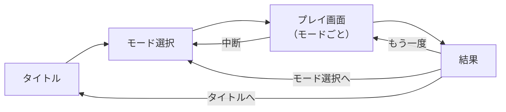

# 漢字クイズ 画面設計書

| 項目 | 内容 |
|---|---|
| 状態 | 確定（実装に合わせて更新する。未実装の画面は案） |
| 最終更新 | 2026-10-24 |
| 関連 | [GameSpec.md](GameSpec.md) / [Architecture.md](Architecture.md) |

---

## 1. 前提

| 項目 | 内容 |
|---|---|
| 対象端末 | PC（Windows）。余裕があればスマートフォンにも対応する |
| 基準解像度 | 1920×1080（16:9） |
| 入力 | マウス。キーボードでも操作できるようにする（1.2） |
| UI | uGUI + TextMeshPro |

### 1.1 スマートフォン対応を見越した決まり

あとからスマートフォンに対応しやすいように、最初から次のようにしておく。

- Canvas Scaler は **Scale With Screen Size**、基準 1920×1080、Match 0.5 にする。
  - StrokeOrder と Result のシーンは設定済み。
- ボタンや選択肢は、指で押せる大きさにする（基準解像度で縦 120px 以上）。
- マウスオーバーでしか見えない情報は作らない。
- 画面の端には重要な UI を置かない（スマートフォンのノッチ対策）。

### 1.2 キーボード操作

| キー | 操作 |
|---|---|
| 1〜6（テンキーも可） | 選択肢を選ぶ（実装済み） |
| Enter / Space / → | 次へ（実装済み。結果発表の演出中は演出を飛ばす） |
| ← | 前の問題へ（実装済み） |
| Esc | 中断メニューを開く・閉じる（実装済み） |
| F1 | テスト用の難易度切り替えボタンの表示・非表示（エディタと開発ビルドのみ、実装済み） |

### 1.3 フォント

- **Klee One**（SIL Open Font License 1.1）を使う。教科書体に近い字形で、漢字の形が問われるゲームに向いている。
- TextMeshPro のフォントアセットは Dynamic にし、TMP Settings の既定のフォントにしている。
- 背景は学校で配られるプリントの画像（少しくすんだ再生紙に繊維の粒と印刷の外枠）、文字は濃いグレー（#2B2B2B）、強調色は朱色（#C84B31）。
- 画面の切り替えは、前の画面のプリントを回収して次の画面のプリントを配る（全画面共通。GameSpec.md 4.3）。新しい画面の Canvas は Screen Space - Camera で作る。

---

## 2. 画面遷移



---

## 3. 各画面

### 3.1 タイトル

```
┌──────────────────────────────────────────┐
│                                          │
│              漢 字 ク イ ズ               │
│                                          │
│              [ はじめる ]                 │
│              [ 設定 ]                     │
│              [ おわる ]                   │
│                                          │
│  KanjiVG © Ulrich Apel (CC BY-SA 3.0)    │
└──────────────────────────────────────────┘
```

- KanjiVG のクレジットはタイトル画面の下に表示する（クレジット画面を作るなら移す）。

### 3.2 モード選択

```
┌──────────────────────────────────────────┐
│ [← 戻る]          モード選択               │
│                                          │
│  ┌────────┐ ┌────────┐ ┌────────┐       │
│  │書き順   │ │本物の  │ │返信文  │       │
│  │クイズ   │ │漢字さがし│ │クイズ  │       │
│  └────────┘ └────────┘ └────────┘       │
│  ┌────────┐ ┌────────┐                  │
│  │四字熟語 │ │画像で  │                  │
│  │づくり   │ │名前当て │                  │
│  └────────┘ └────────┘                  │
│                                          │
│  難易度： ( やさしい ) ( ふつう ) ( むずかしい ) │
│                       [ スタート ]         │
└──────────────────────────────────────────┘
```

- モードを選ぶと、下にモードの説明を出す。
- 難易度がないモードでは、難易度の選択を隠す。

### 3.3 プレイ画面（全モード共通の枠）

```
┌──────────────────────────────────────────┐
│ 書き順クイズ（簡単）     3 / 10 問 [メニュー] │ ← ヘッダー
│ ■■■□□□□□□□                             │ ← 進行バー
├──────────────────────────────────────────┤
│                                          │
│              問題エリア                   │ ← モードごとに変わる
│                                          │
├──────────────────────────────────────────┤
│                                          │
│              回答エリア                   │ ← モードごとに変わる
│                                          │
├──────────────────────────────────────────┤
│ 操作キーの案内  [← 前へ]       [次へ →]  │ ← フッター
└──────────────────────────────────────────┘
```

- [メニュー] で中断メニュー（続ける、最初からやり直す、効果音の音量）を開く。詳細は GameSpec.md 4.4。
- 新しいモードのシーンは、シーンテンプレート「漢字クイズのモード」から作る（GameSpec.md 4.6）。

- ヘッダー、進行バー、フッターは全モード共通のプレハブにする。
- 回答を選ぶまで [次へ] は押せない状態にする。

### 3.4 プレイ画面（モードごとの中身）

**書き順クイズ**

```
│  この漢字の正しい書き順はどれ？     「漢」     │
├──────────────────────────────────────────┤
│ ( ) 丶 氵 氵 汁 …（1画ずつ積み上げた図）       │
│ ( ) 丶 氵 氵 汁 …                           │
│ ( ) 丶 氵 氵 汁 …                           │
```

- 画数が多い漢字は横に長くなる。横幅に収まらないときは、図を縮小して1行に収める（実装済み）。
- 1段階ずつの図を黒い四角で囲む（漢字練習帳のマス目のイメージ）。
- 行のどこをクリックしても、その行の選択肢を選べる。
- 振り返りのときは、正解の行を緑、選んだ不正解の行を赤にし、行の右端に「正解」「あなたの回答」を出す。

**本物の漢字さがし**

```
│        本物の漢字はどれ？                     │
├──────────────────────────────────────────┤
│   ┌────┐  ┌────┐  ┌────┐  ┌────┐        │
│   │ 偽 │  │ 本 │  │ 偽 │  │ 偽 │        │
│   └────┘  └────┘  └────┘  └────┘        │
```

**返信文クイズ**

```
│  ┌──────────────────────────────┐        │
│  │ 先輩：明日の会議、資料の準備を   │        │
│  │ お願いできる？                  │        │
│  └──────────────────────────────┘        │
├──────────────────────────────────────────┤
│  [ 承知しました。         ]              │
│  [ 承地しました。         ]              │
│  [ 了承しました。         ]              │
```

- 状況はチャット風の吹き出しで見せる。

**四字熟語づくり**

```
│        □ □ □ □                          │ ← 4つの枠
├──────────────────────────────────────────┤
│   [一] [石] [二] [鳥] [三] [日]           │ ← 漢字の候補
```

- 候補をクリックすると左の空いた枠に入る。枠をクリックすると候補に戻る。
- ドラッグ操作はスマートフォン対応のときに検討する。

**画像で名前当て**

```
│            ┌──────────┐                  │
│            │  (画像)   │                  │
│            └──────────┘                  │
├──────────────────────────────────────────┤
│  [ 蒲公英 ]  [ 向日葵 ]  [ 紫陽花 ]  [ 秋桜 ] │
```

### 3.5 結果

```
┌──────────────────────────────────────────┐
│                  結果                     │
│              5 / 7 問 正解               │
│                                          │
│  花丸     1. 漢  ○   6. 字  ×    [5級]    │
│ (全問     2. 令  ○   7. …       自己ベスト │
│  正解)    …                    6 / 7 問  │
│                                 更新！    │
│   [もう一度]          [問題を振り返る]       │
└──────────────────────────────────────────┘
```

- 左に全問正解の花丸、真ん中に問題ごとの ○×（○ はハンコの画像）、右に級のハンコと自己ベストを置く。
- 演出の順番は GameSpec.md 3.0 を参照。

- [もう一度] の右に、同じ大きさの [問題を振り返る] を置く。最初に間違えた問題から振り返りを開く（詳細は GameSpec.md 3.5）。
- 一覧の問題をクリックしても、その問題の振り返りを開く。
- [モード選択へ]・[タイトルへ] は、それぞれの画面ができてから追加する。

---

## 4. 未決定事項

- 中断メニューの [やめる]（モード選択・タイトルへ戻る）。それらの画面ができてから足す
- 設定画面の内容（BGM の音量、表示サイズなど）。効果音の音量は中断メニューにある
- 色やデザインのテーマ
