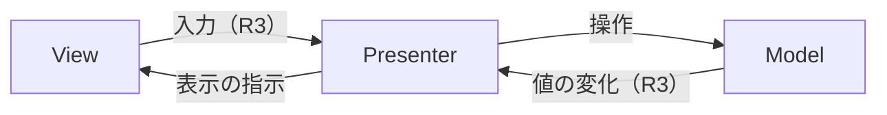

# 漢字クイズ（KanjiQuiz）

漢字をテーマにした5種類のクイズで遊べる PC 向けゲームです。
就職活動用のポートフォリオ作品として、1人で開発しています。

| 項目 | 内容 |
|---|---|
| エンジン | Unity 6000.4.3f1（URP） |
| 言語 | C# |
| 対象端末 | PC（Windows）。スマートフォン対応を予定 |
| 開発体制 | 1人 |
| 開発期間 | 〜2027年1月（予定） |

## ゲームモード

| モード | 内容 | 状況 |
|---|---|---|
| 書き順クイズ | 正しい書き順の図を選ぶ | 遊べる |
| 本物の漢字さがし | 偽物の漢字の中から実在する漢字を選ぶ | 予定 |
| 返信文クイズ | 状況に合った正しい返信の文を選ぶ | 予定 |
| 四字熟語づくり | 漢字を組み合わせて四字熟語を作る | 予定 |
| 画像で名前当て | 画像を見て名称の漢字を当てる | 予定 |

今後、プレイヤーが問題を作ってオンラインで共有できる機能を追加する予定です。

### 書き順クイズ

- 3つの選択肢から、正しい書き順の図を選びます。図は1画ずつ積み上げて描き、1段階ごとにマス目で囲みます。
- 難易度は3段階です。

| 難易度 | 出題範囲 | 問題数 | 不正解の作り方 |
|---|---|---|---|
| 簡単 | 小学漢字 | 5問 | 全画をランダムに並べ替える |
| 常識 | 常用漢字（小学漢字を除く） | 7問 | 連続した30%の画を入れ替える |
| 困難 | 常用漢字以外 | 7問 | 隣り合う2画を1か所だけ入れ替える |

- 結果画面では正解数と問題ごとの正誤を表示し、各問題を振り返れます。

## 設計

**MVP（Model-View-Presenter）** で作っています。

### この設計にした理由

- **5つのモードで共通の流れを1回だけ書くため。**
  「出題、回答、判定、次の問題、結果」の流れを Presenter の基底クラスにまとめ、各モードは違う部分だけを実装しています。
- **ロジックをテストできるようにするため。**
  Model と Presenter は MonoBehaviour に依存しない C# クラスです。採点、不正解の生成、画面の進行などを EditMode テスト（84 件）で確認しています。
- **画面とデータを差し替えやすくするため。**
  View はロジックを持たないので、PC 版とスマートフォン版で作り分けられます。問題データはインターフェース経由で読み込むので、将来のオンライン共有にも対応できます。

### 使用技術

| 技術 | 用途 |
|---|---|
| R3 | View から Presenter へのイベント通知、Model の値の変化の通知 |
| UniTask | 書き順の描画、SVG の読み込みなどの非同期処理 |
| uGUI / TextMeshPro | UI |
| Input System | 入力 |
| Unity Test Framework | EditMode テスト |

## ドキュメント

| 資料 | 内容 |
|---|---|
| [仕様書](Docs/GameSpec.md) | ゲームのルールと機能 |
| [アーキテクチャ設計書](Docs/Architecture.md) | クラス構成と設計の理由 |
| [画面設計書](Docs/ScreenDesign.md) | 画面レイアウトと遷移 |
| [コーディング規約](Docs/CodingRules.md) | 命名規則、フォルダ構成、Git の運用 |
| [進行状況](Docs/Progress.md) | 進み具合、スケジュール、次にやること |

## クレジット

書き順データには [KanjiVG](https://kanjivg.tagaini.net/) を使用しています。
KanjiVG © Ulrich Apel, licensed under [CC BY-SA 3.0](https://creativecommons.org/licenses/by-sa/3.0/).

出題範囲の漢字の一覧は、[KANJIDIC2](https://www.edrdg.org/kanjidic/) から作成しています。
KANJIDIC2 © Electronic Dictionary Research and Development Group, licensed under [CC BY-SA 4.0](https://creativecommons.org/licenses/by-sa/4.0/).

フォントには [Klee One](https://github.com/fontworks-fonts/Klee) を使用しています。
Copyright 2020 The Klee Project Authors, licensed under the [SIL Open Font License 1.1](https://scripts.sil.org/OFL).
